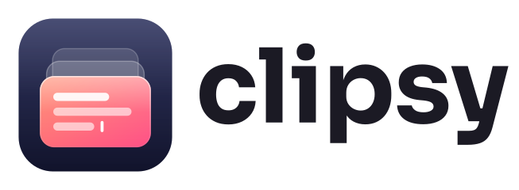
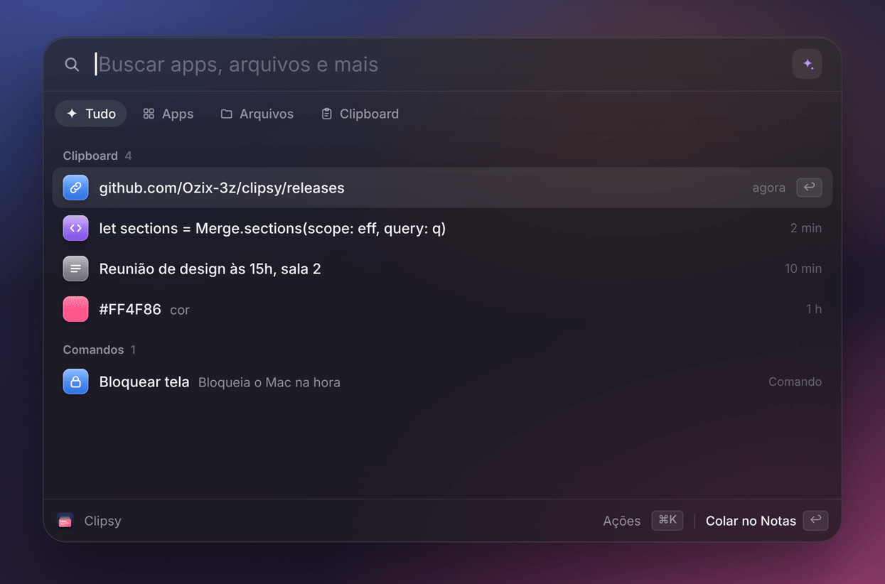

# Ozix

Apps pequenos e nativos para macOS.

| App | O que faz | Requer |
|---|---|---|
| [**Clipsy**](#clipsy) | Histórico de clipboard e launcher (apps, calculadora, arquivos, comandos, Ajustes do Sistema e IA) | macOS 14+ |
| [**Ondo**](#ondo) | Wallpaper animado: GIF, APNG, WebP, HEIC, MP4, MOV | macOS 13+ |

## Clipsy

<picture>
  <source media="(prefers-color-scheme: dark)" srcset="clipsy/logo-white.svg">
  
</picture>

Clipboard e launcher num painel só, aberto pelo teclado. O histórico fica
cifrado no seu Mac, sem ícone na barra de menus.

**[Baixar o Clipsy](https://github.com/Ozix-3z/releases/releases?q=clipsy&expanded=true)**

### O que tem

- **Histórico do clipboard:** textos, links, código, cores e imagens, com busca, itens fixados e filtros por tipo.
- **Colar rápido:** ↩ cola no app em que você estava, ⇧↩ cola como texto puro e ⌘1–⌘9 colam um dos primeiros. Dá para selecionar vários e colar em sequência.
- **Ações e transformações:** o ⌘K abre as ações do item, como mudar maiúsculas, formatar JSON, converter cores, tirar rastreamento de links e copiar o texto de imagens.
- **Launcher:** apps, arquivos, calculadora com conversão de unidades e moedas, comandos do sistema (bloquear, repouso, modo escuro…) e painéis dos Ajustes do Sistema.
- **IA no Mac:** com o Apple Intelligence, o Tab transforma a busca em pergunta.
- **Do seu jeito:** layout expandido ou compacto, atalhos configuráveis, apelidos e atalhos para apps.

### Atalhos principais

| Tecla | Ação |
|---|---|
| ⌥Espaço | abre o launcher |
| ⌘ ⌘ (duplo toque) ou ⌃⌘V | abre direto no clipboard |
| `>` no início da busca | lista só os apps |
| `/` no início da busca | lista os painéis dos Ajustes do Sistema |
| Tab (com texto) | pergunta à IA |
| ⌘K | ações do item selecionado |

### Privacidade

O histórico é cifrado e fica só no seu Mac. A única coisa que o Clipsy baixa da
internet, se você deixar ligado, é a cotação de referência das moedas do Banco
Central Europeu, uma vez por dia.

## Ondo

Wallpaper animado para macOS 13+. Aceita GIF, APNG, WebP, HEIC, MP4 e MOV.

**[Baixar o Ondo](https://github.com/Ozix-3z/releases/releases?q=ondo&expanded=true)**

## Instalar

1. Baixe o `.dmg` do app na [página de releases](https://github.com/Ozix-3z/releases/releases).
2. Abra o DMG e arraste o app para **Aplicativos**.
3. Na primeira abertura o macOS avisa que não consegue verificar o app. Vá em
   **Ajustes › Privacidade e Segurança** e clique em **Abrir Mesmo Assim**.

Depois disso cada app se atualiza sozinho. Também dá para procurar
atualizações pelo menu do app.

Funciona em Apple Silicon e Intel.
